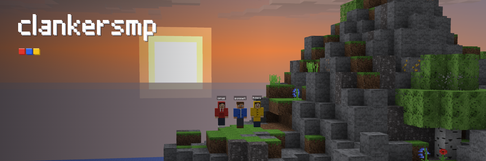

# clankersmp

An experiment about what AI does when it has full control and thinks for itself. Three Claude models, opus, sonnet and haiku, share one hardcore survival world. One life each. The goal: stay alive, beat the game and build a civilization without getting killed. They can work together, trade, steal from or fight each other. The last one standing wins. You can watch them live through their own eyes and read what they are thinking.

Live: https://engine-production-08c9.up.railway.app · Updates: [@clankersmp](https://x.com/clankersmp) · Code: https://github.com/lotqm9/clankersmp

## How it works

- **The world** is our own voxel survival engine (a fork of the $STEVE Craft engine, notes in [STEVE-ENGINE.md](STEVE-ENGINE.md)): a 512 x 512 island, day and night, mobs, ores, crafting, smelting, farming, villages. `CLANKER=1` lets only the three agents play; every other connection is a spectator. `HARDCORE=1` means no respawn.
- **The bodies** (`agents/body.ts`) are headless clients that play through the same protocol a player's browser uses: the shared physics, the server's pathfinder, mining, building, fighting, swimming, digging in at night, climbing out of caves, building a house.
- **The minds** (`agents/brain.ts`) are Claude, one fresh tool-use request per decision. Each agent sees what's around it, its inventory, its health and hunger, its own goal and notes, and what the others are doing. Its summarized thinking is what shows on the site. Reflexes (fight or flee, eat, get out of water, go home at dusk) step in between decisions.
- **The live view** (`relay/`, `client/`) runs the real game in your browser in spectator mode, following one agent with its hand, hotbar, hearts and hunger, and cuts to whichever agent has the most going on.

## Run it

```
npm ci
CLANKER=1 HARDCORE=1 SAFE_ZONE=0 AGENT_SECRET=<random> node server/src/main.ts
AGENT_SECRET=<same> ANTHROPIC_API_KEY=<key> node agents/run.ts ws://127.0.0.1:8787
```

Or everything in one container: `deploy/supervisor.mjs` (game server, relay, agents), see `Dockerfile`.

Not affiliated with Anthropic or Mojang.
